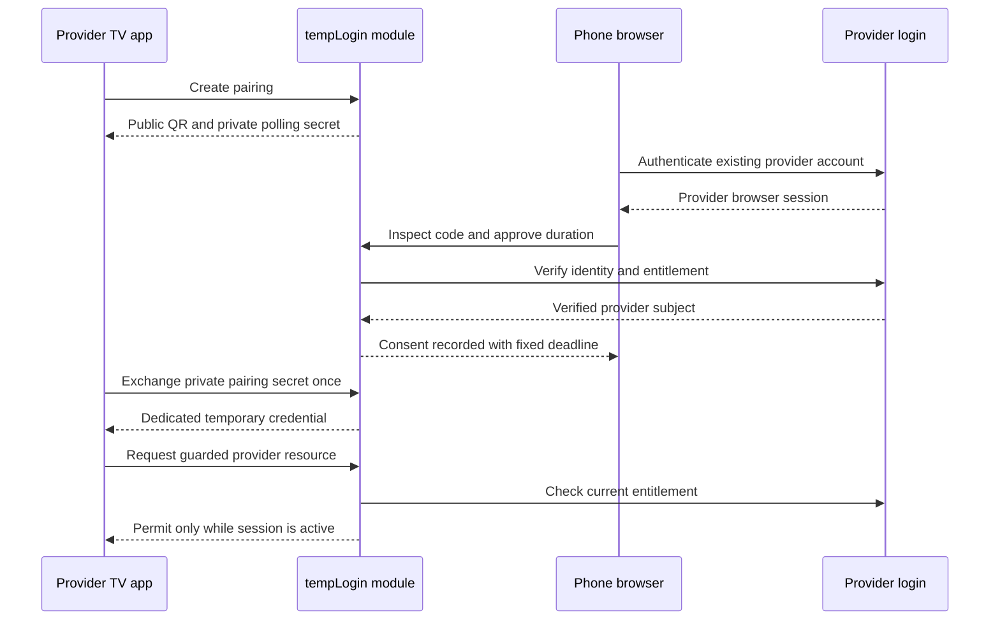

# Provider-owned architecture

The provider can host every component. tempLogin does not need a separate account service or a cross-provider credential vault. The TV uses a dedicated temporary session; phone authentication stays with the provider.

The sequence represents callback invocations, not undocumented remote APIs. In an embedded deployment, identity and entitlement checks can be local service calls.

SQL tables `tl_pairings` and `tl_provider_sessions` are independent of the archived `users` and `passkeys` tables. The reference host still creates historical tables for backward compatibility but the default flow never inserts accounts there. The production adapter must supply a stable, opaque provider subject; the fictional local adapter uses an isolated random demo-browser identity.

Pairing state is `pending → approved → consumed` or `pending → denied`. Expiration is an absolute timestamp checked before each operation. A grant is active only if its session exists, is unrevoked, has not expired, belongs to the configured provider and passes entitlement checks. Deleting a session fails closed. No background job is needed to enforce the deadline.

The package only provides authorization for endpoints that call its guard. It cannot invalidate an unrelated native-app cookie or stop a pre-issued media licence. The provider binds those operations to the returned session and deadline. A central multi-provider broker, federation signing and third-party session provisioning would be additional systems, not hidden capabilities of this implementation.
