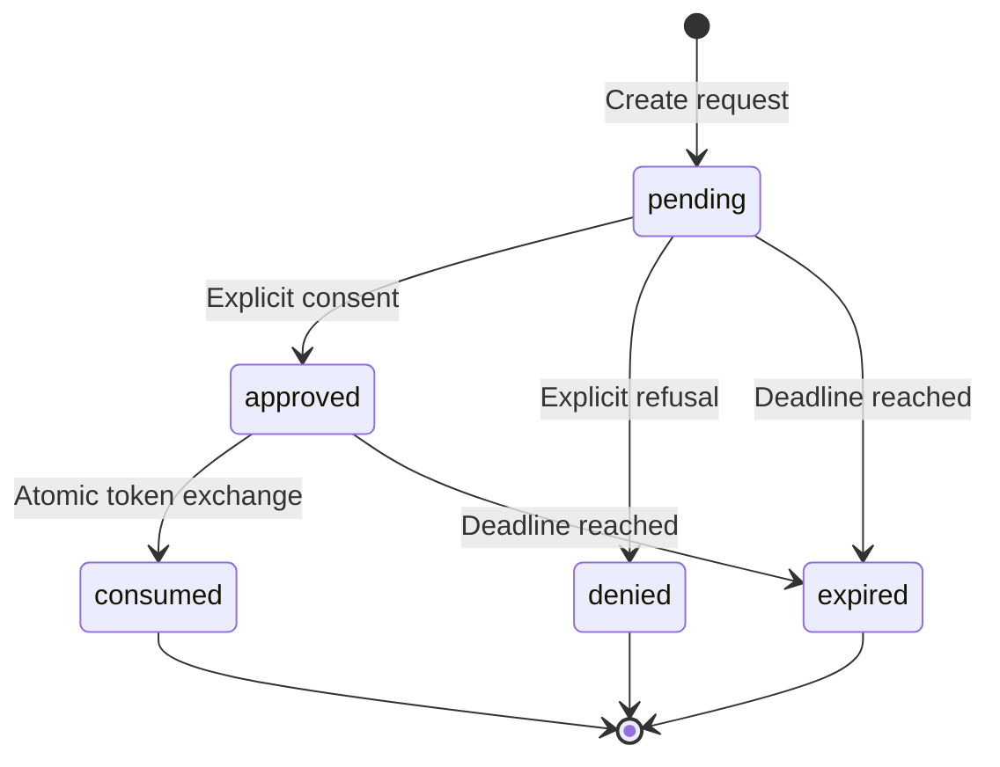

# tempLogin protocol, version 1 (reference candidate)

This document specifies the reference application's wire behavior, separately from its browser UI. It borrows the device-authorization pattern from RFC 8628. It does **not** claim to implement a general OAuth authorization server or complete RFC 8628 conformance: requests use JSON, supported clients are explicitly configured, and protocol extensions include matching codes and hospitality bindings.

## Trust and participants

The personal browser authenticates the user with a passkey. A compatible shared-device client requests consent. The authorization API owns persistent pairing, grants and token state. Protected resources consult that state before providing data. An external provider is a distinct security domain; account linking alone does not create a session in its TV application.

Approval is not authentication, and scanning is not approval. The user must authenticate, inspect the client and requested scopes, compare the displayed code, choose duration, and submit an explicit decision.

## Messages

All API paths have `/api` prefix; all requests and responses are JSON. Browser mutations require the configured Origin. Device clients without browser cookies may use the designated device endpoints without an Origin header. An incorrect supplied Origin is never accepted. Token responses must not be cached.

1. `POST /pairings` with `client_id`, `device_name`, `scopes`; optionally a registered `device_id` and its `device_secret`. Returns `device_code`, `user_code`, `verification_uri`, `verification_uri_complete`, `expires_in` and `interval`.
2. Display the complete verification URI as a QR and the user code separately. Keep the device code private to the client process. It is never included in the QR.
3. Authenticated phone reads `GET /pairings/{user_code}`. Public clients are labeled **unverified**. Device names are descriptions, not hardware attestation.
4. Authenticated phone sends `POST /pairings/{user_code}/decision` with `approve`, `matching_code`, `scopes` and `duration_seconds`. Accepted scopes must be a subset of requested and client-allowed scopes.
5. Device polls `POST /token` with `grant_type: "urn:ietf:params:oauth:grant-type:device_code"`, `device_code`, `client_id`, waiting at least `interval` seconds between attempts.
6. Successful exchange returns `access_token`, `refresh_token`, `token_type: "Bearer"`, `expires_in`, `scope`, `grant_id`, and `grant_expires_at`. Only one exchange can consume approval.
7. `GET /resource` requires an appropriate bearer access token and the resource scope. TV content requires `content:read`; car preferences require `preferences:read`. `profile:read` separately gates the user's display name.
8. Rotate with `POST /token`, `grant_type: "refresh_token"`, `refresh_token`, `client_id`. Persist the replacement only after success. Reuse of an old refresh token revokes its grant family. Avoid concurrent refreshes and blind retries after an ambiguous network failure; require re-pairing if recovery cannot be established safely.

## Scope and time rules

Allowed demo scopes are `profile:read`, `content:read` and `preferences:read`, filtered by the configured client. No provider credentials are represented by these scopes. Access token expiry and grant expiry are checked during resource authorization, independently of any cleanup job. Refresh never extends the original consent deadline. Registered hospitality grants additionally cannot outlive the stay. All timestamps exposed as `*_at` are epoch milliseconds unless an OpenAPI field states otherwise; `*_seconds` and `expires_in` are seconds.

## Errors and recovery

| Error | Meaning | Client action |
|---|---|---|
| `authorization_pending` | No final consent yet | Continue within polling interval |
| `slow_down` | Polling too frequently | Increase interval as directed; do not busy loop |
| `access_denied` | User refused | Stop; allow deliberate restart |
| `expired_token` | Pairing deadline passed | Stop; user can request a fresh QR |
| `invalid_grant` | Unknown, consumed, revoked or invalid authorization | Stop; re-pair |
| HTTP 401 | Invalid/expired user or device session | Reauthenticate or re-pair |
| HTTP 403 | Origin, scope, recent-auth or access rule failed | Explain; do not retry blindly |
| HTTP 429 | Rate limit exceeded | Honor Retry-After |
| Network unavailable | Server could not verify authorization | Do not present protected access as verified |

## Revocation and offline behavior

`DELETE /grants/{id}`, `POST /grants/revoke-all`, and device logout invalidate native grant access. Every resource request joins/checks persistent authorization state. The guarantee covers subsequent authorization checks, not content already downloaded or a response already authorized. An offline device cannot be forced to erase cached information; demos stop accessing protected content when verification fails and reset local session state. Native hospitality checkout revokes bound grants atomically. It does not erase unrelated third-party sessions.

## Security properties and limits

Opaque random secrets are hashed at rest. Single-use challenges, pairing consumption and refresh transitions are transactional. Browser sessions are HttpOnly; production cookies are Secure. QR matching reduces mistakes but cannot defeat a live attacker showing a valid QR for their own device. An unverified public client cannot prove physical hardware identity. A compromised device can copy its bearer token and any visible data. Future proof-of-possession and hardware attestation require a versioned extension, not an undocumented assumption.

## Compatibility and future extensions

Use explicit versioned capability metadata. Do not silently interpret a provider's account-linking capability as session provisioning or revocation. New clients, scopes, transports, attestation or provider exchanges require published contracts and tests. Integrators must validate origin, server identity, consent, scope, expiry, and server-side revocation. The current reference does not expose arbitrary dynamic client registration.

Standards references: https://www.rfc-editor.org/rfc/rfc8628 and https://www.w3.org/TR/webauthn-3/ .
